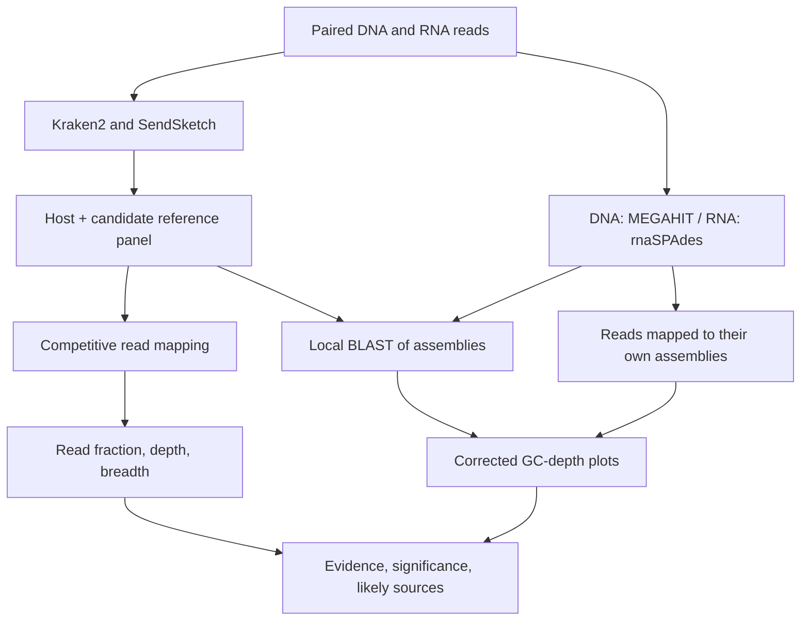

<div align="center">

# Fusarium: beyond the host reads

**A DNA and RNA sequencing investigation of non-target sequence**

Full readsets · Competitive mapping · Local sequence validation · GC–depth plots

[Background](#background) · [Inputs](#inputs) · [Workflow](#workflow) · [Findings](#findings) · [Run it](#run-it) · [Software](#software)

</div>

---

> **Main finding:** FgV1 accounts for **52.51% of the RNA reads**, with **100% coverage breadth** across its reference. Small human-like signals and a three-read bacterial signal need much more cautious interpretation.

| Two complementary datasets | Quantitative validation | Most informative result |
|:---:|:---:|:---:|
| **12.45 million DNA reads** and **27.61 million RNA reads** | Read fraction, mean depth, and breadth | A strong **FgV1 signal in RNA** |

## Background

Sequencing a fungal sample does not guarantee that every read comes from the fungus. A library can also contain sequences from associated organisms, viruses, material introduced during handling, or other samples. Some apparent non-target hits arise because different organisms share similar sequences or because reference databases are incomplete. A species name in a screening report is therefore a starting point for investigation.

This project asks: **Which non-target signals in two Fusarium sequencing datasets are credible, how much of each dataset do they represent, and do they matter for interpretation?** It follows a simple evidence sequence: screen broadly, choose candidate references, measure support by mapping, and examine longer assembled sequences.

The DNA dataset describes sampled genetic material. The RNA dataset emphasizes molecules represented in the RNA library, so expression and library preparation affect its composition. They offer different views, but they are **separate SRA datasets, not verified DNA/RNA samples from the same specimen**. Differences between them cannot establish a treatment effect or a matched biological comparison.

The aim is to distinguish four levels of significance:

| Bin | What it means here |
|---|---|
| **Noise** | The available evidence does not establish a credible detection. |
| **Trace** | A real, very small signal with negligible impact on the intended analysis. |
| **Consequential** | A signal large or important enough to change an analysis. |
| **Biological** | A finding worth reporting in its own right. |

These judgments depend on the evidence and the intended analysis, not a universal read-percentage cutoff. A biological finding can also have analytical consequences.

## Inputs

| Dataset | SRA accession | Raw individual reads | Files |
|---|---|---:|---|
| DNA / WGS | `SRR27384773` | 12,446,790 | `raw/SRR27384773_1.fastq.gz` and mate 2 |
| RNA-seq | `SRR1185280` | 27,608,126 | `raw/SRR1185280_1.fastq.gz` and mate 2 |

Both complete readsets were used without subsampling. Each mate counts as one individual read in the mapping table. There was no separate adapter-trimming or read-quality filtering stage in the supplied workflow; mapping-quality filtering was applied later.

| Reference resource | How it is accessed | Purpose |
|---|---|---|
| Shared Kraken2 index | `/datasets/unzipped/kraken2_full` on ASC | Initial taxonomic screening |
| SendSketch `nt`, `refseq`, `silva` | Online comparisons | Independent sketch-based screening |
| Host and selected candidate FASTAs | Downloaded by accession over HTTPS | Competitive mapping and local BLAST |

The shared Kraken index is reused without a database download. Selected mapping FASTAs are still needed locally. Exact shared-database content/build, RNA strandedness, treatment history, and controls have not been independently verified.

## Workflow

The workflow branches after downloading: mapping quantifies read support, while assembly provides longer sequences for inspection. Both lines of evidence contribute to the final interpretation.



Read the steps below in analysis order. Script numbers preserve the existing project filenames; script 08 packages the final work and is listed last. Expand a step for its exact settings and reasoning.

### 01. Download both complete readsets (script 01)

Script: `01_download.sh`.

| | Description |
|---|---|
| **Input** | Two SRA run IDs: `SRR27384773` and `SRR1185280`. |
| **Process** | Download SRA archives, extract paired FASTQs with fasterq-dump, compress, and check gzip integrity. |
| **Output** | Four compressed paired FASTQ files in `raw/`, plus download/extraction logs. |

<details>
<summary><strong>How this step works: settings, reasoning, and interpretation</strong></summary>

`prefetch` downloads SRA archives; `fasterq-dump --split-files` extracts mates. Each FASTQ is compressed and checked with `gzip -t`. Existing complete pairs are reused; partial pairs stop the script for inspection. Inputs are the two run IDs. Outputs are `raw/SRR27384773_1.fastq.gz`, its mate, and the corresponding RNA pair.

This step does not subsample or perform a separate adapter-trimming or read-quality filtering stage. Do not describe an unperformed QC stage in the methods. The mapping denominator is the raw extracted read count.

</details>

### 02. Screen with Kraken2 and SendSketch (script 02)

Script: `02_screen.sh`.

| | Description |
|---|---|
| **Input** | Paired FASTQs from step 01 and the existing shared Kraken2 database. |
| **Process** | Classify read pairs with Kraken2 and compare whole-readset sketches with online nt, RefSeq, and SILVA. |
| **Output** | Kraken reports in `screen/kraken2/`, SendSketch reports in `screen/sendsketch/`, and `screen/screen_status.tsv`. |

<details>
<summary><strong>How this step works: settings, reasoning, and interpretation</strong></summary>

Kraken2 reads the shared `/datasets/unzipped/kraken2_full` index. It checks for `hash.k2d`, `opts.k2d`, and `taxo.k2d`; it does not download a replacement if they are absent. The run uses paired mode and confidence 0.1. The database name alone does not establish its content or build date; these require cluster documentation.

SendSketch processes both mates against the online `nt`, `refseq`, and `silva` services, with `samplerate=1`, `minkeycount=2`, and up to 100 returned records. It examines all input reads but represents their sequence content as sketches. Its scores are not direct read percentages. Save each returned report and the command-status table; an exit status alone is not a biological finding.

Outputs: `screen/kraken2/*.report.tsv`, per-fragment classification files, `screen/sendsketch/*.txt`, and `screen/screen_status.tsv`. Kraken's paired-mode counts are fragments/read pairs, whereas step 04 counts individual mates. Do not compare their raw counts without accounting for this difference.

</details>

### 03. Prepare a host-plus-candidate reference panel (script 03)

Script: `03_prepare_references.sh`.

| | Description |
|---|---|
| **Input** | Candidate choices from screening and the selected accession list. |
| **Process** | Download and validate selected FASTAs, combine host and candidates, and build Bowtie2/HISAT2 indexes. |
| **Output** | `refs/combined.fa`, Bowtie2/HISAT2 indexes, `metadata/references.tsv`, and `metadata/reference_sequences.tsv`. |

<details>
<summary><strong>How this step works: settings, reasoning, and interpretation</strong></summary>

Selected FASTAs are downloaded over HTTPS, validated, and reused when checksums/source records match. This is a small selected mapping panel relative to a broad screening database, although the human genome makes it large in absolute terms. The panel contains:

| Role | Group | Accession.version |
|---|---|---|
| Host | Fusarium graminearum PH-1 | GCF_000240135.3 |
| Host | F. graminearum mitochondrion | NC_009493.1 |
| Candidate | FgV1 | NC_006937.1 |
| Candidate | Bacillus cereus | GCF_000007825.1 |
| Candidate | Homo sapiens | GCF_000001405.40 |
| Candidate | Peribacillus frigoritolerans | GCA_024169475.1 |
| Candidate | Stenotrophomonas maltophilia | GCF_000072485.1 |
| Candidate | Enterobacter T2 | GCA_010692925.1 |
| Candidate | Bacillus velezensis | GCF_000015785.2 |
| Candidate | Spirosoma pollinicola | GCA_002831565.1 |

Reference headers are renamed to unique group-specific IDs. The correspondence to original accession IDs is saved in `metadata/reference_sequences.tsv`. Host mitochondrial duplication is avoided. The script builds Bowtie2 and HISAT2 indexes for `refs/combined.fa`.

Keeping host and candidates together makes mapping competitive: a read can match the host instead of being forced onto a candidate-only reference. This reduces some false assignments but cannot compensate for organisms or strains missing from the panel. The human FASTA includes alternate/patch regions, which can introduce ambiguous matches and affect the total reference-length denominator.

</details>

### 04. Measure read fraction, breadth, and depth (script 04)

Script: `04_map_measure.sh`; output: `results/measurements.tsv`.

| | Description |
|---|---|
| **Input** | Complete paired reads and the combined reference indexes from step 03. |
| **Process** | Map DNA with Bowtie2 and RNA with HISAT2, retain primary MAPQ >=20 alignments, and calculate read fraction, depth, and breadth. |
| **Output** | Filtered alignments, per-reference statistics, and `results/measurements.tsv`. |

<details>
<summary><strong>How this step works: settings, reasoning, and interpretation</strong></summary>

DNA uses Bowtie2 `--very-sensitive`. RNA uses HISAT2 with no assumed strand orientation. Alignments are sorted, then filtered with `samtools view -q 20 -F 2308` to retain primary mapped alignments. Supplementary and secondary records are removed. The filter does not require proper pairs and does not remove duplicate or QC-fail flags. Overlapping mates count separately.

SAMtools generates coverage reports and index statistics. The final measurement table uses depth sums from `samtools depth -q 0 -Q 0 -g 1792` on the filtered BAM, plus full reference lengths; it is not simply an average of per-sequence coverage rows. With modern SAMtools, depth is uncapped. Deletions and skipped RNA introns are not counted as sequenced bases. Reference positions with no coverage remain in the mean-depth denominator.

Definitions, for a candidate with reference length L:

- Read fraction = retained primary mapped individual reads / all raw individual input reads.
- Read percent = read fraction times 100.
- Breadth percent = reference positions with depth greater than zero / L times 100.
- Mean depth = sum of per-position read depths / L, including zero-covered positions.

These quantities answer different questions. A few reads can match a repeat without supporting an entire organism. RNA genome breadth depends on expression and should not be judged by DNA uniformity expectations. RNA read percentages are not percentages of organisms or cells.

</details>

### 05. Assemble DNA and RNA separately (script 05 + 06)

Scripts: `05_assemble_dna.sh` and `06_assemble_rna.sh`.

| | Description |
|---|---|
| **Input** | DNA and RNA paired FASTQs from step 01, processed separately. |
| **Process** | Assemble DNA with MEGAHIT and RNA with rnaSPAdes, keeping the two datasets separate. |
| **Output** | DNA: `assembly/dna_megahit/final.contigs.fa`; RNA: `assembly/rna_rnaspades/transcripts.fasta`. |

<details>
<summary><strong>How this step works: settings, reasoning, and interpretation</strong></summary>

MEGAHIT assembles all DNA reads with a minimum contig length of 500 bp, producing `assembly/dna_megahit/final.contigs.fa`. This is exploratory assembly, not a claim of a polished fungal genome.

rnaSPAdes assembles all RNA reads and produces `assembly/rna_rnaspades/transcripts.fasta`. No strand-specific setting was selected without verified library orientation. Its transcript labels and coverage fields should not be confused with independent organisms or mapped base depth.

The assemblies can run independently after downloads, provided each has its own resource allocation. Their scripts stop if the output directory already exists; inspect a prior run before using the documented resume command.

</details>

### 06. Compare assembled sequences with the local panel (script 06b)

Use `06b_select_all_candidate_contigs.sh`, which supersedes the earlier FgV1-only selection script.

| | Description |
|---|---|
| **Input** | Both assemblies, `refs/combined.fa`, and the reference ID map. |
| **Process** | Run local blastn against the combined panel, compare candidate versus host support, and select contigs for follow-up. |
| **Output** | Raw alignments, candidate-hit tables, and selected contig FASTAs in `validation/all_candidates/run.*/`. |

<details>
<summary><strong>How this step works: settings, reasoning, and interpretation</strong></summary>

A local nucleotide BLAST index is built from the already downloaded combined panel and keyed by its checksum. The search uses word size 20, E-value 1e-10, at most 100 target sequences, and at most five HSPs per query/subject pair. An HSP is one local alignment segment. Raw output preserves query/reference coordinates, identity, bit score, and lengths.

The script records candidate matches and the strongest host HSP for comparison. Selection for optional follow-up requires identity >=80%, alignment length >=300 bp, and E-value <=1e-20. It selects up to two distinct contigs per candidate per sample. These are selection rules, not biological-significance thresholds. Candidate matches are retained for inspection even if the host has a stronger match.

Outputs are in `validation/all_candidates/run.*/`. The pointer `validation/all_candidates/latest_selection.txt` identifies a completed selection run. Preserve its `reference_sequences.tsv` and `SRR*.raw.tsv`; the plotting steps depend on them.

</details>

### 07. Optional broader remote validation: skipped (script 07)

`07_validate_all_candidate_contigs.sh` sends selected contigs to remote nt BLAST. This was too slow and was skipped. Empty remote logs or submitted requests are not completed validation. This step is not required to draw the local-panel plots. Do not claim that the local panel search confirms a globally best species match.

| | Description |
|---|---|
| **Input** | Selected contig FASTAs from step 06b. |
| **Process** | Submit selected contigs to remote nt BLAST; this optional step was skipped after slow requests. |
| **Output** | If completed: remote nt BLAST hit tables. This project does not claim a completed remote result. |

<details>
<summary><strong>How this step works: settings, reasoning, and interpretation</strong></summary>


</details>

### 08. Build plots using existing local BLAST results (script 09)

Use `09_blobplots_local.sh`, not the superseded `09_blobplots.sh` Kraken-based version.

| | Description |
|---|---|
| **Input** | Each readset and its own assembly, plus the completed local BLAST output. |
| **Process** | Map reads to their own assemblies, calculate per-sequence GC and depth, and add local BLAST labels. |
| **Output** | Per-contig tables and plots in `blobplots_local/`. |

<details>
<summary><strong>How this step works: settings, reasoning, and interpretation</strong></summary>

Both readsets are mapped to their own assemblies with Bowtie2, because the RNA targets here are assembled transcripts rather than genomic references. Primary alignments with MAPQ >=20 are retained. SAMtools coverage provides per-sequence depth and breadth; GC is calculated using A/C/G/T bases. The script combines these measurements with local BLAST evidence and writes `blobplots_local/SRR*_blobplot.tsv` and figures.

The original script classified full/partial support using only the strongest HSP's query coverage. Multiple exon-sized or fragmented matches could therefore make a well-supported sequence look partial. Step 10 corrects this display assessment.

</details>

### 09. Correct combined alignment support and plot layout (script 10)

Script: `10_correct_blobplots.sh`.

| | Description |
|---|---|
| **Input** | Original blobplot TSVs, raw local BLAST alignments, and the matching reference key. |
| **Process** | Merge overlapping qualifying query intervals, recalculate combined support, and redraw plots without remapping. |
| **Output** | Corrected plots, reviewed TSVs, and `review_summary.tsv` in a new `blobplots_corrected/run.*/` folder. |

<details>
<summary><strong>How this step works: settings, reasoning, and interpretation</strong></summary>

This step reads the original plot tables and the recorded step-06b BLAST source. It validates query IDs/lengths against the tables and subject IDs against the reference key. It does not rerun mapping, BLAST, screening, or assembly.

For the original best-reference group, it retains the same qualifying HSP filters, merges overlapping query-coordinate intervals, and counts each query position once. Combined query support is this union length divided by full query length. Groups within 95% of the best individual bit score are flagged as competing. Broad support means at least 80% query union; lower values are partial. Host nuclear and mitochondrial matches share a host group.

New fields are `query_union_bp`, `query_union_percent`, `support_status`, `reported_hsp_cap_reached`, and `best_group_hsp_cap_reached`. Original fields remain unchanged for audit: use the new support fields, not the old `reference_group`/`plot_group`, to interpret the corrected figures.

The figure includes sequences >=300 bp, with readable legends, visible small points, and a depth axis that is linear from zero to one and logarithmic above one. Gray means no qualifying match; it does not mean contaminant. Colored filled circles mean broad support, open circles partial support, and triangles competing groups. Marker area is deliberately not proportional to length because a minimum size is applied. Tables retain all sequences, including shorter ones.

Outputs go to a new `blobplots_corrected/run.*/` folder. `latest_corrected.txt` records the completed folder. PDF is always produced; PNG/SVG require Cairo support in R. Original depth/read counts remain unchanged. Base-R rendering differs slightly from the assistant's earlier figure previews.

</details>

### 10. Package the final submission (script 08)

`08_prepare_submission.sh` creates a detection-table template, a writeup template, and an agent-record placeholder, then packages scripts and metadata. Run or refresh it after the final interpretations are ready, despite its earlier number. It preserves existing files, so it does not replace old values after remapping. Check for `REVIEW_REQUIRED` and other placeholders before submission.

| | Description |
|---|---|
| **Input** | Measurement tables, final judgments, writeup, scripts, metadata, and selected figures. |
| **Process** | Review detection bins and sources, finalize the writeup, and package scripts, metadata, and selected outputs. |
| **Output** | A submission bundle; the repository should also contain the selected final results and actual assistant transcript. |

<details>
<summary><strong>How this step works: settings, reasoning, and interpretation</strong></summary>

The package does not automatically include the newer corrected plots or these documentation files. Add selected final tables, figures, and the real conversation transcript explicitly. A short assistant-use note is not a complete agent transcript. No GitHub push or coursework submission has been performed by these scripts.

</details>

## Findings

The table below reports reference-mapping measurements, not blobplot depths. Percentages use individual-read denominators. Bins and sources are provisional judgments based on the supplied results.

| Dataset / candidate | Retained reads | Read % | Reference breadth % | Mean depth (x) | Assessment and likely source |
|---|---:|---:|---:|---:|---|
| RNA / FgV1 | 14,497,528 | 52.511815 | 100.000000 | 220,615.475996 | Biological; also consequential. Likely virus associated with the sampled culture; natural versus experimental infection is unresolved. |
| DNA / human | 1,034 | 0.008307 | 0.003989 | 0.000047 | Provisional trace. Handling or library carryover is plausible; shared sequences/reference ambiguity remain alternatives. Harmlessness is not demonstrated for every downstream analysis. |
| RNA / human | 645 | 0.002336 | 0.001463 | 0.000019 | Provisional noise/unresolved. Sparse matching is not enough to establish human contamination or its source. |
| RNA / S. maltophilia | 3 | 0.000011 | 0.004617 | 0.000062 | Noise. Too few reads and too little breadth for a credible biological detection; incidental matching is more plausible than a substantial bacterial component. |

DNA had zero retained mapped reads for FgV1 and all six tested bacterial groups. RNA had zero for B. cereus, P. frigoritolerans, Enterobacter T2, B. velezensis, and S. pollinicola. These are non-detections under this panel/filter, not evidence that the samples are sterile or that related strains are absent. Any initial screening suggestions for these candidates lack mapping support here.

The four assignment bins are: noise (not credible), trace (credible but negligible for the analysis), consequential (changes an analysis), and biological (worth reporting in its own right). A finding can have both biological interest and analytical consequences; if one bin is required, use biological for FgV1 and state its consequences separately.

### Why FgV1 is the strongest finding

Over half the RNA reads mapped to the 6,624-base viral reference, and every reference base had retained coverage. This is much stronger than a few reads matching a conserved region. Assembly comparison provides additional sequence support: 54 transcripts had FgV1 as their best panel group, and 53 reached at least 80% combined query support. They are redundant assembled sequences, not 54 independent viruses.

The likely source is a viral component of the sampled fungal culture. These results do not establish infectivity, symptoms, natural infection, or exclude deliberate infection or substantial sample carryover. Those distinctions require sample metadata and controls. Do not use failure to detect FgV1 in the separate DNA run as a matched-sample test for integration.

### What changed in the corrected plots

| Measure | DNA | RNA |
|---|---:|---:|
| Assembly sequences in the tables | 260 | 20,510 |
| Broad reference support after correction | 67 | 12,403 |
| Partial support after correction | 65 | 1,050 |
| No qualifying panel hit | 128 | 7,057 |
| Partial labels that gained >=80% combined support | 38 | 2,164 |
| Query/subject pairs reaching the five-HSP limit | 402 | 706 |

There were 123 DNA sequences with a host best group and nine with a human best group; all nine human-best sequences reached >=80% query union. This strengthens a human-like sequence signal within the panel, but is not independent broad taxonomic validation. The RNA table had 13,399 host-best sequences. Of its 7,057 unmatched sequences, 6,614 were shorter than 300 bp and could not meet the minimum alignment-length rule.

## Run it

### Environment and project setup

The scripts were written for ASC and use this project path:

```bash
WD="/scratch/aubaxp004/fusarium_screen_v2"
```

For a **new environment**, run from the repository root:

```bash
source ~/miniconda3/etc/profile.d/conda.sh
CONDA_CHANNEL_PRIORITY=strict conda env create -f environment.yml
conda activate contamination
mkdir -p "$WD"/{scripts,raw/sra,tmp,logs,metadata,screen/sendsketch,screen/kraken2,refs,mapping,assembly,results,validation}
```

For an existing working environment, activate it rather than reinstalling it. `environment.yml` is a portable dependency list, not a lockfile. Its dependency solve has not been tested here. The old `00_setup.sh` predates the full plotting dependency list; use the YAML when preparing a new installation.

### Submit a stage

```bash
cd /scratch/aubaxp004/fusarium_screen_v2/scripts
/scripts/run_script 04_map_measure.sh
```

Replace the script name with the stage you need. The wrapper is ASC-specific. Each computational script activates Conda inside the job and uses absolute paths, because the scheduler may change its working directory.

Wait for prerequisites to finish successfully before submitting dependent jobs. Check logs and expected output files; a job disappearing from `qstat` does not establish success. DNA and RNA assembly may run independently once downloads finish, with separate resource allocations.

Most analysis scripts use eight threads. Assembly scripts set a 48 GB memory limit, so the job allocation should leave additional memory for overhead. Full Kraken screening and human-inclusive indexing can require substantial memory. The table-only correction step is much lighter. More allocated CPUs do not change a script's `THREADS` setting.

### Record the environment actually used

```bash
conda list -n contamination --explicit > "$WD/metadata/conda-linux-explicit.txt"
conda env export -n contamination --no-builds > "$WD/metadata/environment-resolved.yml"
```

The explicit export is platform-specific. Keep reference accessions, checksums, and database provenance alongside software versions. Review machine-specific paths and URLs before publishing exports.

## Software

| Tool | Why it was included |
|---|---|
| SRA Toolkit | Downloads runs and extracts paired FASTQ reads. |
| BBTools/SendSketch | Quickly compares read sketches with online reference collections. |
| Kraken2 | Screens reads against the existing shared database without downloading another database. |
| Bowtie2 | Maps DNA reads to the combined panel and both libraries to their own assemblies. |
| HISAT2 | Allows splice-aware mapping of RNA reads to genomic references. |
| SAMtools | Sorts, filters, indexes, counts alignments, and measures coverage. |
| MEGAHIT | Provides an exploratory assembly of the DNA readset. |
| SPAdes/rnaSPAdes | Provides an RNA-specific transcript assembly. |
| BLAST+ | Compares contigs/transcripts to the selected local reference panel. |
| Base R | Draws plots and recalculates query-interval support without extra R packages. |
| curl / Java | Provides HTTPS reference downloads and the BBTools runtime. |

Standard ASC shell utilities include Bash, awk, sort, gzip, tar, sha256sum, and flock. Python may be installed internally by SPAdes or other tools; the user-facing workflow is Bash with embedded R.

## Repository guide

| Path | What belongs here | Git policy |
|---|---|---|
| `README.md` | Project story, workflow, results, and instructions | Keep |
| `summary.md` / `summary.pdf` | Simple one-page account of the work | Keep |
| `environment.yml` | Required software | Keep |
| `scripts/` | Actual scripts used for analysis | Keep |
| `metadata/` | Reference manifests, checksums, software/database records | Keep after review |
| `screen/` | Small Kraken reports and SendSketch results | Keep reports; exclude per-read classifications |
| `results/` | Final measurements and reviewed detection table | Keep |
| `results/figures/` | Selected corrected PNG/PDF/SVG figures | Keep |
| `results/blobplot_tables/` | Reviewed per-sequence tables and correction summary | Keep |
| `raw/`, `refs/`, `mapping/`, `assembly/` | Large data and rebuildable intermediate files | Ignored |
| `validation/`, `blobplots_local/`, `blobplots_corrected/` | Working outputs; retain locally | Ignored; copy final selections into `results/` |

The repository records the methods and selected evidence. Raw data can be retrieved using the SRA accessions. `.gitignore` excludes working data but does not remove files already tracked by Git.

<details>
<summary><strong>Copy final figures into the repository</strong></summary>

After a successful step-10 job:

```bash
WD="/scratch/aubaxp004/fusarium_screen_v2"
OUT=$(cat "$WD/blobplots_corrected/latest_corrected.txt")
mkdir -p "$WD/results/figures" "$WD/results/blobplot_tables"
cp "$OUT"/*_revised_blobplot.pdf "$WD/results/figures/"
cp "$OUT"/*_reviewed.tsv "$WD/results/blobplot_tables/"
cp "$OUT/review_summary.tsv" "$WD/results/blobplot_tables/"
# PNG and SVG are available when the plotting R installation supports Cairo.
for FILE in "$OUT"/*_revised_blobplot.png "$OUT"/*_revised_blobplot.svg; do
    [[ -f "$FILE" ]] && cp "$FILE" "$WD/results/figures/"
done
```

</details>

## Scope and reproducibility

Completed supplied outputs cover read screening, competitive mapping, assembly, local panel BLAST, and original plots. Corrected plots/tables were generated from those outputs. The supplied `10_correct_blobplots.sh` was Bash-syntax checked; completion of that script on ASC has not yet been confirmed in the project record.

Remote nt BLAST was attempted and skipped because of runtime. The earlier Kraken-based assembly plot job was superseded by the local-BLAST version. No Bracken, sourmash, UNITE, geNomad, DIAMOND, CheckV, FCS-GX, or BlobToolKit result is claimed. These are custom plots. No spike-ins were performed, so no empirical detection limit is available.

- **Limited reference coverage:** a best panel match can be misleading if alternatives are absent. The exact shared Kraken database content/build remains unverified.
- **BLAST reporting caps:** five HSPs and 100 targets limit reported evidence. Reaching a cap suggests possible truncation, not proof of omitted hits. Union support may be incomplete; low support alone does not establish chimerism.
- **RNA mapping ambiguity:** similar assembled transcripts compete for reads. MAPQ filtering can make individual viral transcripts appear weakly covered even though the separate viral reference is deeply covered. Do not substitute the reference-genome depth into transcript points.
- **RNA interpretation:** expression, transcript redundancy, and library selection prevent direct conversion of read fraction to cell abundance. Assembly header coverage is not the measured mapped-base depth.
- **Source attribution:** there are no evaluated negative controls, batch comparisons, or verified treatment histories here. Reagent contamination, index hopping, handling, and genuine biology cannot always be separated.
- **Detection limit:** no spike-ins were performed. A zero count is conditional on this panel and these filters.

### Assistant contribution

The assistant drafted Bash scripts, reviewed uploaded result tables and local BLAST alignments, and generated corrected figures locally. The student ran the HPC workflow. If the assignment requires an agent transcript, include the actual conversation export; the placeholder produced by script 08 is not a full transcript.

### Submission checklist

- [ ] Include the actual script versions and environment records.
- [ ] Add `measurements.tsv` and a reviewed detection table with bins and evidence.
- [ ] Replace all submission-template placeholders.
- [ ] Add the one-page summary and selected final plots.
- [ ] Include reference/database provenance and the actual assistant transcript.
- [ ] Inspect `git diff --cached --stat` before committing.

## Sources and documentation

Project measurements come from the supplied `measurements.tsv`, original blobplot tables, raw local BLAST output, and corrected review tables. Settings were checked against the project scripts.

- [Kraken2 manual](https://github.com/DerrickWood/kraken2/blob/master/docs/MANUAL.markdown)
- [rnaSPAdes documentation](https://ablab.github.io/spades/rna.html)
- [SAMtools depth manual](https://www.htslib.org/doc/samtools-depth.html)

Current software documentation may differ from the versions originally used. The saved environment records identify the actual installation.

---

*Screening proposes candidates. Mapping measures support. Interpretation weighs the evidence.*
